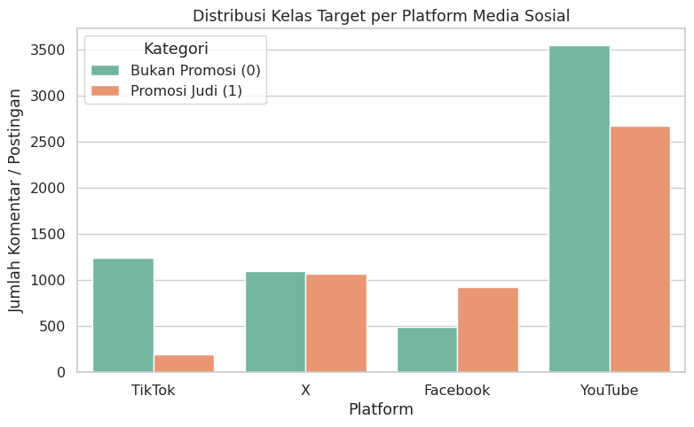
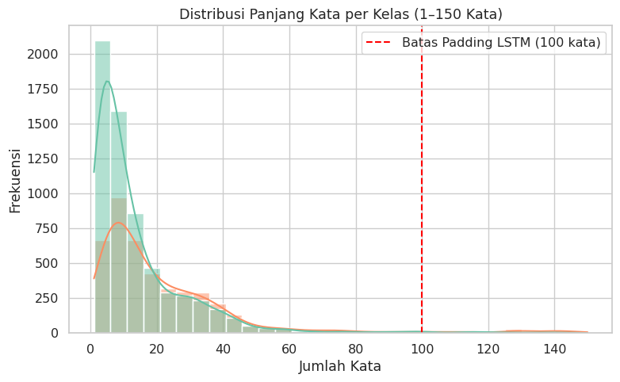
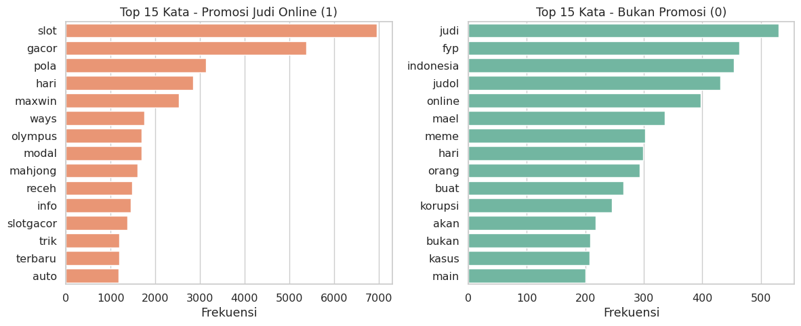

## INFORMASI PROYEK

**Judul Proyek**:
["Klasifikasi Teks Promosi Judi Online Berbahasa Indonesia pada Media Sosial dan Komentar YouTube Menggunakan Machine Learning dan Deep Learning"]

**Identitas Kelompok:**

| Nama                      | NIM       | Program Studi                      |
| ------------------------- | --------- | ---------------------------------- |
| Alan Herva Ikhsan Saputra | 244311001 | Teknologi Rekayasa Perangkat Lunak |
| Davin Rafael Suryatmoko   | 244311007 | Teknologi Rekayasa Perangkat Lunak |

**Mata Kuliah:** Data Science  
**Dosen Pengampu:** Gus Nanang Syaifuddiin, S.Kom., M.Kom.  
**Tahun Akademik:** Tahun 2024 / Semester 5  
**Link GitHub Repository:**  
**Link Video Pembahasan:**  
**SDG yang Dipilih:**
| ID | Deskripsi |
| -- | --------- |
| SDG 3 | Good Health and Well-Being (Kehidupan Sehat dan Sejahtera) |
| SDG 16 | Peace, Justice and Strong Institutions (Perdamaian, Keadilan, dan Kelembagaan yang Tangguh) |

**Target SDG yang Relevan:** [misal: Target 3.4 – mengurangi kematian dini akibat penyakit tidak menular]
| Target | Deskripsi |
| -- | --------- |
| 3.4 | membantu mengidentifikasi promosi judi online yang berpotensi mendorong perilaku perjudian dan berdampak pada kesejahteraan masyarakat. |
| 16.6 | bentuk dukungan teknologi untuk membantu proses identifikasi konten promosi judi online. |

---

## 0. KERANGKA ML LIFECYCLE (L-M-O-P)

Laporan ini disusun mengikuti **ML Lifecycle** yang terdiri dari empat tahap berulang (iteratif):

| Tahap                  | Singkatan | Inti Pertanyaan                                                               | Bagian Laporan        |
| ---------------------- | --------- | ----------------------------------------------------------------------------- | --------------------- |
| **Learning Problem**   | **L**     | Apa target, objective, dan datanya?                                           | Bab 2, 3, 4, 5        |
| **Model Design**       | **M**     | Model family/arsitektur apa, hypothesis space, dan inductive bias/asumsi apa? | Bab 6 (6.x.1 – 6.x.3) |
| **Optimization**       | **O**     | Bagaimana model dilatih: loss, optimizer, tuning, regularisasi, konvergensi?  | Bab 6 (6.x.4 – 6.x.6) |
| **Predict & Evaluate** | **P**     | Seberapa baik prediksi model berdasarkan metrik evaluasi?                     | Bab 7                 |

```
   L (Learning Problem) ──► M (Model Design) ──► O (Optimization) ──► P (Predict & Evaluate)
          ▲                                                                   │
          └─────────────── iterasi / perbaikan berdasarkan hasil evaluasi ────┘
```

**Catatan untuk mahasiswa:** Setiap bagian diberi label **[L]**, **[M]**, **[O]**, atau **[P]**. Pastikan Anda dapat menjelaskan keterkaitan antar tahap, misalnya bagaimana hasil **P** mendorong perbaikan pada **L/M/O** (Bab 7.5).

---

## 1. LEARNING OUTCOMES

Pada proyek ini, mahasiswa diharapkan dapat:

1. **[L]** Mengidentifikasi masalah nyata dari **ide sendiri** yang selaras dengan salah satu tujuan **SDGs** ([Agenda 2030 – sdgs.un.org/2030agenda](https://sdgs.un.org/2030agenda)), lalu merumuskan problem statement (target, objective, data) secara jelas
2. **[L]** Melakukan analisis dan eksplorasi data (EDA) secara komprehensif (**OPSIONAL**)
3. **[L]** Melakukan data preparation yang sesuai dengan karakteristik dataset
4. **[M]** Merancang tiga model machine learning dengan justifikasi hypothesis space dan inductive bias (**WAJIB**):
   - Model baseline
   - Model machine learning / advanced
   - Model deep learning (**WAJIB**)
5. **[O]** Mengoptimasi model secara sistematis (loss function, optimizer, hyperparameter tuning, regularisasi)
6. **[P]** Menggunakan metrik evaluasi yang relevan dengan jenis tugas ML dan menganalisis hasilnya
7. Melaporkan hasil eksperimen secara ilmiah dan sistematis
8. Mengunggah seluruh kode proyek ke GitHub (**WAJIB**)
9. Menerapkan prinsip software engineering dalam pengembangan proyek

---

## 2. PROJECT OVERVIEW **[L]**

### 2.1 Latar Belakang

Judi online menjadi salah satu permasalahan serius di ruang digital Indonesia karena promosinya tersebar luas di media sosial dan kolom komentar YouTube dalam berbagai variasi teks. Banyaknya konten tersebut membuat proses penyaringan secara manual memakan waktu dan kurang efektif.

Penelitian sebelumnya oleh Riza et al. (2025) membuktikan bahwa pemrosesan teks seperti normalisasi karakter Unicode dan pembobotan TF-IDF yang dikombinasikan dengan algoritma Naive Bayes efektif menyaring komentar spam promosi judi online pada YouTube. Selain itu, studi oleh Pratama et al. (2026) juga menunjukkan bahwa pendekatan Natural Language Processing dengan algoritma berbasis pohon keputusan seperti Random Forest mampu mengklasifikasikan komentar promosi judi online secara otomatis dengan tingkat akurasi tinggi. Oleh karena itu, proyek ini membandingkan tiga pendekatan model—Naive Bayes, Random Forest, dan LSTM—untuk mengklasifikasikan teks promosi judi online pada media sosial dan komentar YouTube.

> Riza, F. J. M., Guntara, R. G., & Nugraha, M. R. (2025). Implementasi Algoritma Naive Bayes untuk Filtrasi Spam Komentar Judi Online pada YouTube. _Indonesian Journal of Digital Business_, 5(2), 411–423. https://doi.org/10.17509/ijdb.v5i2.88641

> Pratama, M. L. A., Yusuf, M. E., Ramdhani, M. R., Fathoni, & Ibrahim, A. (2026). Deteksi dan Klasifikasi Konten Promosi Judi Online pada Media Sosial YouTube Menggunakan Pendekatan Natural Language Processing dan Machine Learning. _JATI (Jurnal Mahasiswa Teknik Informatika)_, 10(3). https://doi.org/10.36040/jati.v10i3.18440

### 2.2 Keterkaitan dengan SDGs (WAJIB)

Ide proyek **berasal dari mahasiswa** dan harus selaras dengan **salah satu** dari 17 Sustainable Development Goals (daftar dan contoh inspirasi ada di Lampiran A).

| Komponen                 | Pertanyaan Panduan                                                             | Jawaban Anda                                                                                                            |
| ------------------------ | ------------------------------------------------------------------------------ | ----------------------------------------------------------------------------------------------------------------------- |
| **SDG yang dipilih**     | Goal nomor berapa dan apa namanya?                                             | [ SDG 3 – Good Health and Well-Being (Kehidupan Sehat dan Sejahtera). ]                                                 |
| **Target SDG**           | Target (misal 3.4, 13.1) mana yang paling relevan?                             | [ Target 3.4 – Meningkatkan kesehatan mental dan kesejahteraan. ]                                                       |
| **Masalah nyata**        | Masalah konkret apa yang diangkat? Siapa yang terdampak?                       | [ Promosi judi online dapat mendorong masyarakat untuk mencoba perjudian dan berpotensi berdampak pada kesejahteraan. ] |
| **Peran ML**             | Mengapa ML/DL cocok? Apa keputusan atau proses yang dibantu?                   | [ Membantu mengidentifikasi dan mengklasifikasikan konten promosi judi online secara otomatis. ]                        |
| **Indikator kontribusi** | Bagaimana hasil model berkontribusi pada target SDG (langsung/tidak langsung)? | [ Kemampuan model dalam mendeteksi konten promosi berdasarkan nilai F1-Score, Precision, dan Recall. ]                  |
| **Pertimbangan etika**   | Risiko bias, privasi, atau dampak salah prediksi?                              | [ Memperhatikan privasi, lisensi dataset, bias data, dan kesalahan klasifikasi. ]                                       |

**Sumber ide:** [Berasal dari permasalahan penyebaran promosi judi online di media sosial yang menjadi perhatian masyarakat Indonesia.]

### 2.3 Ringkasan Alur Lifecycle Proyek

Jelaskan dalam 1 paragraf pendek bagaimana proyek Anda melewati tahap L → M → O → P (dan iterasi apa yang direncanakan).

**[Proyek dimulai dengan menentukan masalah dan mengumpulkan dataset teks promosi judi online. Selanjutnya, data dibersihkan dan dipersiapkan sebelum digunakan untuk melatih tiga model, yaitu Naive Bayes, Random Forest, dan LSTM. Setelah pelatihan, setiap model diuji dan dibandingkan menggunakan metrik evaluasi. Hasil evaluasi digunakan untuk menentukan model dengan performa terbaik dan melakukan perbaikan jika diperlukan.]**

---

## 3. BUSINESS UNDERSTANDING / PROBLEM UNDERSTANDING **[L]**

### 3.1 Problem Statements

1. Banyak konten promosi judi online tersebar di media sosial dan kolom komentar YouTube dengan variasi penulisan yang beragam.
2. Identifikasi dan penyaringan konten promosi secara manual membutuhkan waktu serta tenaga yang besar.
3. Diperlukan model klasifikasi otomatis yang mampu membedakan teks promosi judi online dan bukan promosi secara akurat.
4. Diperlukan perbandingan beberapa pendekatan model (baseline, machine learning, dan deep learning) untuk menentukan model dengan performa terbaik.

### 3.2 Formulasi Learning Problem (WAJIB)

Rumuskan masalah dalam kerangka _Learning Problem_:

| Komponen      | Pertanyaan Panduan                                                                                          | Jawaban Anda                                                                                                                                                                                                                                                             |
| ------------- | ----------------------------------------------------------------------------------------------------------- | ------------------------------------------------------------------------------------------------------------------------------------------------------------------------------------------------------------------------------------------------------------------------ |
| **Target**    | Apa yang diprediksi? Jenis tugas (klasifikasi biner/multikelas, regresi, forecasting, clustering, dll.)?    | [ Mengklasifikasikan teks menjadi dua kelas: promosi judi online (1) dan bukan promosi judi online (0). Jenis tugas: Binary Classification. ]                                                                                                                            |
| **Objective** | Apa yang dioptimalkan/diminimalkan secara matematis (misal: cross-entropy, MSE)? Metrik keberhasilan utama? | [ Meminimalkan kesalahan prediksi menggunakan fungsi loss Cross-Entropy dan memperoleh nilai F1-Score yang baik. ]                                                                                                                                                       |
| **Data**      | Sumber, ukuran, jenis, dan asumsi tentang data (i.i.d.? distribusi train vs test?)                          | [ Gabungan dataset teks berbahasa Indonesia dari Indonesian Online Gambling Promotion Multimodal Dataset (0xRafie, 5.028 data) dan dataset hasil crawling mandiri komentar YouTube berbahasa Indonesia (6.219 data), dengan total 11.247 data berlabel biner (0 dan 1) ] |

### 3.3 Goals

1. Mengolah dan membersihkan gabungan dataset teks promosi judi online dari media sosial dan komentar YouTube hingga siap digunakan untuk pemodelan.
2. Membangun dan melatih tiga pendekatan model klasifikasi teks, yaitu Multinomial Naive Bayes, Random Forest, dan Long Short-Term Memory (LSTM).
3. Membandingkan performa ketiga model menggunakan metrik evaluasi yang relevan (F1-Score, Accuracy, Precision, dan Recall).
4. Menentukan model terbaik dengan target capaian nilai F1-Score di atas 0,85 pada data pengujian (_test set_).
5. Mendukung upaya pencapaian SDG 3 (Target 3.4) melalui penyediaan model deteksi otomatis untuk membantu mengurangi paparan konten promosi judi online.

> Sertakan minimal satu goal yang menunjukkan kontribusi terhadap target SDG yang dipilih (Bab 2.2).

\*\*[1. Mengolah dataset promosi judi online menjadi data yang siap digunakan.

2. Membangun tiga model, yaitu Naive Bayes, Random Forest, dan LSTM.

3. Membandingkan performa ketiga model menggunakan metrik evaluasi.

4. Menentukan model terbaik berdasarkan nilai F1-Score.

5. Membantu proses identifikasi konten promosi judi online melalui klasifikasi teks.]\*\*

### 3.4 Solution Approach **[M]**

Mahasiswa **WAJIB** menggunakan minimal **tiga model** dengan komposisi sebagai berikut:

#### **Model 1 – Baseline Model**

Model sederhana sebagai pembanding dasar.
**Pilihan model:**

- Linear Regression (untuk regresi)
- Logistic Regression (untuk klasifikasi)
- K-Nearest Neighbors (KNN)
- Decision Tree
- Naive Bayes

\*\*[Multinomial Naive Bayes

Model ini dipilih sebagai pembanding awal karena sederhana dan cocok untuk klasifikasi teks. Model memprediksi kategori berdasarkan pola kemunculan kata dalam teks.]\*\*

#### **Model 2 – Advanced / ML Model**

Model machine learning yang lebih kompleks.
**Pilihan model:**

- Random Forest
- Gradient Boosting (XGBoost, LightGBM, CatBoost)
- Support Vector Machine (SVM)
- Ensemble methods
- Clustering (K-Means, DBSCAN) - untuk unsupervised
- PCA / dimensionality reduction (untuk preprocessing)

\*\*[Random Forest

Random Forest dipilih karena menggunakan gabungan beberapa Decision Tree untuk menghasilkan prediksi. Model ini akan digunakan untuk membandingkan kemampuan klasifikasi terhadap Naive Bayes.]\*\*

#### **Model 3 – Deep Learning Model (WAJIB)**

Model deep learning yang sesuai dengan jenis data.
**Pilihan Implementasi (pilih salah satu sesuai dataset):**
**A. Tabular Data:**

- Multilayer Perceptron (MLP) / Neural Network
- Minimum: 2 hidden layers
- Contoh: prediksi harga, klasifikasi binary/multiclass

**B. Image Data:**

- CNN sederhana (minimum 2 convolutional layers) **ATAU**
- Transfer Learning (ResNet, VGG, MobileNet, EfficientNet) - **recommended**
- Contoh: klasifikasi gambar, object detection

**C. Text Data:**

- LSTM/GRU (minimum 1 layer) **ATAU**
- Embedding + Dense layers **ATAU**
- Pre-trained model (BERT, DistilBERT, Word2Vec)
- Contoh: sentiment analysis, text classification

**D. Time Series:**

- LSTM/GRU untuk sequential prediction
- Contoh: forecasting, anomaly detection

**E. Recommender Systems:**

- Neural Collaborative Filtering (NCF)
- Autoencoder-based Collaborative Filtering
- Deep Matrix Factorization

**Minimum Requirements untuk Deep Learning:**

- ✅ Model harus training minimal 10 epochs
- ✅ Harus ada plot loss dan accuracy/metric per epoch
- ✅ Harus ada hasil prediksi pada test set
- ✅ Training time dicatat (untuk dokumentasi)

**Tidak Diperbolehkan:**

- ❌ Copy-paste kode tanpa pemahaman
- ❌ Model tidak di-train (hanya define arsitektur)
- ❌ Tidak ada evaluasi pada test set

\*\*[Long Short-Term Memory (LSTM)

LSTM dipilih karena dapat mempelajari urutan kata dalam sebuah kalimat. Model ini digunakan untuk mengenali pola teks promosi judi online yang lebih kompleks.

Model akan dilatih minimal 10 epoch, kemudian dievaluasi menggunakan data testing. Hasil training akan ditampilkan melalui grafik loss dan accuracy.]\*\*

---

## 4. DATA UNDERSTANDING **[L]**

### 4.1 Informasi Dataset

**Sumber Dataset:**

1. **Indonesian Online Gambling Promotion Multimodal Dataset** (Hugging Face – `0xRafie`): https://huggingface.co/datasets/0xRafie/indonesian-gambling-multimodal-dataset (5.028 data dari platform Facebook, TikTok, dan X).
2. **YouTube Comments Gambling Dataset** (hasil _crawling_ mandiri dari kolom komentar YouTube berbahasa Indonesia sebanyak 6.219 data).

**Deskripsi Dataset (Gabungan):**

- **Jumlah baris (rows):** 11.247 data (5.028 data dari `0xRafie` + 6.219 data dari komentar YouTube)
- **Jumlah kolom (columns/features):** 5 kolom (`id`, `text_caption`, `image_path`, `platform`, `label`)
- **Tipe data:** Teks dan Gambar (_Multimodal_ pada dataset `0xRafie`, sedangkan dataset YouTube murni teks; penelitian ini hanya memakai fitur teks)
- **Ukuran dataset:** Sekitar 938,7 MB secara keseluruhan (938 MB dari dataset `0xRafie` termasuk file gambar, dan 683 KB atau 0,67 MB dari file CSV komentar YouTube)
- **Format file:** CSV dan JPG (untuk file gambar pada dataset `0xRafie`)

### 4.2 Deskripsi Fitur

Jelaskan setiap fitur/kolom yang ada dalam dataset.
**Contoh tabel:**
| Nama Fitur | Tipe Data | Deskripsi | Contoh Nilai |
|------------|-----------|-----------|--------------|
| id | Integer | ID unik data | 1, 2, 3 |
| text_caption | String | Teks atau caption postingan | "Daftar sekarang bonus member baru" |
| image_path | String | Lokasi file gambar | image/image_1.jpg |
| platform | Categorical | Asal platform media sosial | Facebook, TikTok, X, Youtube |
| label | Float | Kategori konten | 0.0 atau 1.0|

**Fitur yang digunakan dalam penelitian:**

Fokus utama pemodelan adalah kolom `text_caption` sebagai fitur input dan `label` sebagai target prediksi. Kolom `platform` digunakan sebagai kunci stratifikasi saat pembagian data agar distribusi asal platform tetap seimbang di setiap subset. Kolom `id` dan `image_path` tidak digunakan dalam pemodelan karena penelitian ini berfokus pada klasifikasi teks.


### 4.3 Kondisi Data

Jelaskan kondisi dan permasalahan data:

- **Missing Values:** [Tidak ditemukan *missing values* (0% pada seluruh 11.247 baris dan 5 kolom).]
- **Duplicate Data:** [Ada ditemukan **210 duplikat** pada kolom `text_caption` sebelum pembersihan (dan bertambah menjadi 575 duplikat setelah penyeragaman huruf serta penghapusan simbol pada tahap *Data Preparation*).]
- **Outliers:** [Ada, panjang teks memiliki rata-rata **27,45 kata** (standar deviasi 56,27) dan median **11 kata**, namun terdapat *outlier* teks sangat panjang hingga **1.371 kata**. Untuk menjaga efisiensi pelatihan model LSTM, panjang urutan input dibatasi pada **100 kata**.]
- **Imbalanced Data:** [Ya dataset gabungan memiliki distribusi kelas yang relatif berimbang, yaitu **56,74% bukan promosi (6.381 data)** dan **43,26% promosi judi online (4.866 data)**]
- **Noise:** [Ada ditemukan berbagai variasi teks tidak baku khas media sosial dan komentar YouTube, meliputi **2.450 teks (21,78%)** yang mengandung tautan (`http`), **742 teks (6,60%)** yang mengandung `@mention`, serta penggunaan emoji, simbol/font khusus Unicode (seperti `𝐁𝐀𝐑𝐃𝐈𝟒𝐃`), dan kombinasi huruf-angka (seperti `g4cor` atau `slot88`).]
- **Data Quality Issues:** [Proporsi label berbeda mencolok antar platform (Facebook didominasi konten promosi, sedangkan TikTok didominasi non-promosi). Selain itu, pada komentar YouTube berlabel `1.0` terdapat sebagian kecil komentar curhat atau sindiran terhadap judi online yang ikut terlabel positif karena mengandung kata kunci seperti *"slot"* atau *"rungkad"*.]
- **Asumsi Data (i.i.d., distribusi train-test, potensi data leakage):** [Data diasumsikan mewakili pola konten yang akan diklasifikasikan. Data training dan testing harus dipisahkan agar tidak terjadi data leakage.]

### 4.4 Exploratory Data Analysis (EDA) - (**OPSIONAL**)

**Requirement:** Minimal 3 visualisasi yang bermakna dan insight-nya.
**Contoh jenis visualisasi yang dapat digunakan:**

- Histogram (distribusi data)
- Boxplot (deteksi outliers)
- Heatmap korelasi (hubungan antar fitur)
- Bar plot (distribusi kategori)
- Scatter plot (hubungan 2 variabel)
- Wordcloud (untuk text data)
- Sample images (untuk image data)
- Time series plot (untuk temporal data)
- Confusion matrix heatmap
- Class distribution plot

#### Visualisasi 1: Distribusi Kelas Target per Platform Media Sosial



**Insight:**  
Platform YouTube menyumbang jumlah data terbanyak (6.219 data), diikuti X (2.167 data), TikTok (1.442 data), dan Facebook (1.419 data). Karena rasio label `0` dan `1` berbeda di tiap platform, pembagian data perlu menggunakan *stratified split* berbasis gabungan `platform` dan `label` agar setiap subset mewakili seluruh platform secara proporsional.

#### Visualisasi 2: Distribusi Panjang Kata per Kelas



**Insight:**  
Sebaran jumlah kata berbentuk menceng ke kanan dengan nilai median 11 kata, di mana mayoritas komentar maupun caption memiliki panjang di bawah 50 kata. Penetapan batas *padding* sebesar **100 kata** pada model LSTM sudah mencakup hampir seluruh distribusi utama dokumen tanpa terbebani *outlier* hingga 1.371 kata.

#### Visualisasi 3: Top 15 Kata Paling Sering Muncul per Kelas



**Insight:**  
Pada kelas **Promosi Judi Online**, kata yang paling mendominasi adalah istilah teknis dan ajakan permainan seperti *slot* (6.954 kali), *gacor* (5.374 kali), *pola* (3.133 kali), *maxwin* (2.530 kali), dan *olympus* (1.700 kali). Sebaliknya, kata umum seperti *judi* (531 kali), *judol* (431 kali), dan *online* (398 kali) justru banyak muncul pada kelas **Bukan Promosi (0)** dalam konteks diskusi umum atau berita. Perbedaan kosakata yang kontras ini menunjukkan bahwa fitur berbasis pembobotan kata (TF-IDF) maupun urutan kata (LSTM) sangat sesuai untuk membedakan kedua kelas.

---

## 5. DATA PREPARATION **[L]**

Bagian ini menjelaskan **semua** proses transformasi dan preprocessing data yang dilakukan.

### 5.1 Data Cleaning

**Aktivitas:**
1. **Penggabungan Dataset & Reset ID:** Menggabungkan `hf_dataset.csv` (5.028 data) dan `youtube_comments_dataset.csv` (6.219 data) menjadi 11.247 data, lalu memperbarui urutan kolom `id` dari `1` hingga `11.247` agar tidak terjadi tabrakan nomor indeks.
2. **Konversi Tipe Data Target:** Mengubah tipe data kolom `label` dari `float64` (`0.0` dan `1.0`) menjadi `int64` (`0` dan `1`) agar sesuai dengan format target klasifikasi biner.
3. **Normalisasi Unicode (`NFKC`):** Menerapkan `unicodedata.normalize('NFKC')` untuk mengonversi karakter *stylized Unicode* (seperti `𝐁𝐀𝐑𝐃𝐈𝟒𝐃`) menjadi huruf alfabet standar.
4. **Pembersihan Noise & Normalisasi Leetspeak:** Mengubah teks menjadi huruf kecil (*lowercase*), menghapus tautan URL, `@mention`, emoji, serta tanda baca non-alfabet, dan menerjemahkan angka penyamaran pada kata campuran huruf-angka (`4`→`a`, `3`→`e`, `1`→`i`, `0`→`o`, `5`→`s`, `7`→`t`) agar kata seperti `g4cor` terbaca sebagai `gacor`.
5. **Penghapusan Baris Kosong & Deduplikasi:** Menghapus **114 baris** yang menjadi kosong setelah pembersihan (teks yang semula hanya berisi tautan atau emoji) serta **575 baris duplikat**, sehingga menyisakan **10.558 data unik bersih**.

### 5.2 Feature Engineering

**Aktivitas:**
1. **Ekstraksi Fitur TF-IDF (Unigram & Bigram):** Untuk model *Multinomial Naive Bayes* dan *Random Forest*, teks bersih diekstraksi menggunakan `TfidfVectorizer(max_features=5000, ngram_range=(1, 2))` agar model mampu menangkap bobot kata tunggal sekaligus frasa kunci dua kata (seperti *"slot gacor"* atau *"bonus member"*).
2. **Tokenisasi Sekuens Integer:** Untuk model *Deep Learning* (LSTM), setiap kata dikonversi menjadi indeks bilangan bulat menggunakan Keras `Tokenizer(num_words=10000, oov_token="<OOV>")`.

### 5.3 Data Transformation

**Aktivitas:**
1. **Case Folding & Filtering Karakter:** Seluruh teks diseragamkan menjadi huruf kecil dan disaring hanya menyisakan karakter alfabet (`a-z`) serta spasi.
2. **Sequence Padding & Truncating:** Untuk menyamakan dimensi input pada layer *Embedding* LSTM, seluruh urutan token diseragamkan panjangnya menjadi **100 token** (`maxlen=100`, `padding='post'`). Pemilihan batas 100 token didasarkan pada hasil EDA di mana ~95% dokumen bersih memiliki panjang $\le 100$ kata.

### 5.4 Data Splitting

Sebanyak **10.558 data bersih** dibagi menggunakan **Stratified Split** berdasarkan kombinasi kolom `platform` dan `label` dengan `random_state=42`:

- **Training set:** 80% (**8.446 sampel** — Label `0`: 4.878 [57,76%], Label `1`: 3.568 [42,24%])
- **Validation set:** 10% (**1.056 sampel** — Label `0`: 610 [57,77%], Label `1`: 446 [42,23%])
- **Test set:** 10% (**1.056 sampel** — Label `0`: 610 [57,77%], Label `1`: 446 [42,23%])

**Alasan Pemilihan Strategi Splitting:**  
Rasio **80 : 10 : 10** dipilih agar porsi 80% (8.446 sampel) memberikan cakupan kosakata yang memadai bagi pelatihan LSTM dan Random Forest, sementara masing-masing 10% (1.056 sampel) sudah representatif untuk validasi (*tuning* dan *EarlyStopping*) serta pengujian akhir (*test set*). Penggunaan *stratified split* berbasis gabungan `platform` dan `label` menjamin proporsi kelas target maupun asal platform tetap seragam di setiap subset, dan `random_state=42` menjamin hasil pembagian bersifat *reproducible*. Seluruh proses *fitting* `TfidfVectorizer` dan `Tokenizer` dilakukan **hanya pada training set** untuk mencegah *data leakage*.

### 5.5 Data Balancing

Tidak dilakukan teknik *oversampling* sintetis (seperti SMOTE) maupun *undersampling* karena rasio kelas pada data latih sudah relatif seimbang (**57,76% kelas 0** vs **42,24% kelas 1**).

### 5.6 Ringkasan Data Preparation

| Langkah | Apa yang Dilakukan | Mengapa Penting | Bagaimana Implementasinya |
| :--- | :--- | :--- | :--- |
| **1. Integrasi & Cleaning Teks** | Menggabungkan 2 dataset, normalisasi NFKC, *lowercase*, hapus URL/mention/simbol, dan konversi *leetspeak*. | Menyatukan sumber data dan menyamakan variasi penulisan spam judi online agar dikenali sebagai fitur yang sama. | Menggunakan `pd.concat()`, modul `unicodedata`, dan regex (`re`) dalam fungsi `bersihkan_teks()`. |
| **2. Deduplikasi & Filtering** | Menghapus 114 baris kosong dan 575 duplikat setelah pembersihan (tersisa 10.558 data). | Mencegah teks kembar bocor ke *validation/test set* yang dapat membuat skor evaluasi bias. | Menggunakan `.drop_duplicates(subset=["clean_text"])` pada Pandas. |
| **3. Stratified Splitting** | Membagi data menjadi 8.446 *train*, 1.056 *val*, dan 1.056 *test* berdasarkan `platform` + `label`. | Menjaga proporsi kelas (~57,8% : 42,2%) dan komposisi platform tetap merata di setiap subset. | Menggunakan `train_test_split(..., stratify=df_clean["strat_key"], random_state=42)`. |
| **4. TF-IDF & Sequence Padding** | Pembobotan TF-IDF (5.000 fitur, unigram-bigram) dan tokenisasi + *padding* (panjang 100). | Mengubah teks tidak terstruktur menjadi representasi numerik bagi model ML klasik dan LSTM tanpa *data leakage*. | `TfidfVectorizer` dan Keras `Tokenizer` di-*fit* hanya pada `train_df`, lalu di-*transform* ke `val_df` dan `test_df`. |

---

## 6. MODELING **[M + O]**

### 6.1 Model 1 — Baseline Model

#### 6.1.1 Deskripsi Model **[M]**

**Nama Model:** Multinomial Naive Bayes  
**Teori Singkat:**   
Multinomial Naive Bayes adalah algoritma klasifikasi probabilistik berbasis Teorema Bayes yang menghitung probabilitas suatu dokumen termasuk ke dalam kelas tertentu berdasarkan kemunculan dan bobot kata di dalamnya.   
**Alasan Pemilihan:**  
Multinomial Naive Bayes dipilih sebagai *baseline* karena sesuai dengan karakteristik dataset teks dalam proyek ini yang direpresentasikan ke dalam matriks TF-IDF berdimensi tinggi (5.000 fitur *sparse* unigram dan bigram) serta memiliki perbedaan kosakata yang kontras antar kelas (seperti *slot*, *gacor*, *pola*, dan *maxwin* pada kelas promosi vs kosakata percakapan umum pada kelas bukan promosi). Selain sederhana dan memiliki waktu pelatihan sangat cepat, model ini bisa berperan sebagai tolok ukur dasar untuk mengukur peningkatan performa dari model *advanced* (Random Forest) dan *deep learning* (LSTM).

#### 6.1.2 Hypothesis Space & Inductive Bias **[M]**

- **Model family / arsitektur:** Probabilistic Generative Classifier
- **Hypothesis space:** Himpunan fungsi klasifikasi linear pada ruang logaritma probabilitas fitur kata, di mana keputusan kelas ditentukan oleh penjumlahan skor *log-likelihood* setiap kata/frasa ditambah *log-prior* kelas.
- **Inductive bias / asumsi:** Mengasumsikan *conditional independence* (setiap kata/frasa dianggap saling independen satu sama lain apabila kelasnya telah diketahui) serta menerapkan pendekatan *bag-of-words* yang mengabaikan urutan dan struktur tata bahasa dalam kalimat.
- **Implikasi terhadap dataset Anda:** Asumsi ini cocok untuk mendeteksi teks promosi yang secara eksplisit memuat kata kunci perjudian, tetapi memiliki keterbatasan dalam memahami konteks kalimat yang mengandung negasi, edukasi, atau sindiran (misalnya *"stop judi online"* atau keluhan korban *"rungkad main slot"*), serta promosi terselubung dengan variasi penulisan yang jarang muncul pada data latih.

#### 6.1.3 Implementasi (Ringkas) **[M]**

```python
from sklearn.naive_bayes import MultinomialNB

model_baseline = MultinomialNB(alpha=1.0, fit_prior=True)
model_baseline.fit(X_train, y_train)
y_val_pred = model_baseline.predict(X_val)
```

#### 6.1.4 Optimization: Objective, Hyperparameter & Regularisasi **[O]**

**Objective/loss yang dioptimalkan:** [log-likelihood kelas terhadap fitur TF-IDF dan Regularisasi Laplace Smoothing]  
**Parameter yang digunakan:**

```
- alpha: 1.0
- fit_prior: true
```

#### 6.1.5 Hasil Awal **[O → P]**

Evaluasi awal dilakukan pada **Validation Set (1.056 sampel)** menggunakan `tfidf_vectorizer.joblib` yang di-*fit* hanya pada data latih (*test set* tetap disimpan untuk evaluasi akhir pada Bab 7):

| Subset Data | Accuracy | Precision | Recall | F1-Score |
| :--- | :---: | :---: | :---: | :---: |
| **Training Set** (8.446 sampel) | 0,9092 | 0,9618 | 0,8175 | 0,8838 |
| **Validation Set** (1.056 sampel) | **0,8693** | **0,9400** | **0,7377** | **0,8266** |

**Detail Evaluasi per Kelas (Validation Set):**

| Kelas | Precision | Recall | F1-Score | Support |
| :--- | :---: | :---: | :---: | :---: |
| **0 - Bukan Promosi** | 0,8343 | 0,9656 | 0,8951 | 610 |
| **1 - Promosi Judi Online** | 0,9400 | 0,7377 | 0,8266 | 446 |
---

### 6.2 Model 2 — ML / Advanced Model

#### 6.2.1 Deskripsi Model **[M]**

**Nama Model:** [Random Forest Classifier]  
**Teori Singkat:**  
[Random Forest merupakan algoritma Machine Learning yang menggabungkan banyak Decision Tree untuk menghasilkan keputusan klasifikasi.Dalam proyek ini, Random Forest digunakan untuk mengklasifikasikan teks promosi judi online berdasarkan fitur teks yang sudah diubah menjadi representasi angka menggunakan TF-IDF.]

**Alasan Pemilihan:**  
[Mengapa memilih model ini? Random Forest dipilih karena mampu mempelajari pola yang lebih kompleks dibandingkan model baseline. Algoritma ini juga dapat menangkap hubungan antarfitur dan tidak hanya bergantung pada hubungan linear.]

**Keunggulan:**

- Mampu mempelajari pola yang kompleks.


- Menggabungkan banyak Decision Tree sehingga hasil prediksi lebih stabil.


- Dapat digunakan untuk klasifikasi data teks yang sudah diubah menjadi fitur numerik.

**Kelemahan:**

- Membutuhkan sumber daya komputasi lebih besar dibandingkan Naive Bayes.


- Proses pelatihan dapat lebih lama ketika jumlah pohon meningkat.


- Hasilnya dapat sulit diinterpretasikan karena terdiri dari banyak pohon keputusan.

#### 6.2.2 Hypothesis Space & Inductive Bias **[M]**

- **Model family / arsitektur:** [Ensemble Learning berbasis Decision Tree]
- **Hypothesis space:** [Kumpulan fungsi keputusan non-linear yang dibentuk dari gabungan banyak pohon keputusan
- **Inductive bias / asumsi:** [Menggunakan pemisahan fitur berdasarkan kondisi atau threshold tertentu]
- **Perbandingan dengan baseline:** [apa yang bisa dipelajari model ini yang tidak bisa baseline? Random Forest mampu mempelajari pola kombinasi fitur yang lebih kompleks, sedangkan Naive Bayes menggunakan pendekatan probabilitas]

#### 6.2.3 Implementasi (Ringkas) **[M]**

```python
from sklearn.ensemble import RandomForestClassifier
from sklearn.metrics import accuracy_score, f1_score, precision_score, recall_score

# Menggunakan X_train, X_val dari TF-IDF vectorizer yang di-fit pada data latih (8.446 train, 1.056 val)
model_advanced = RandomForestClassifier(
    n_estimators=100,
    max_depth=None,
    min_samples_split=2,
    random_state=42,
    n_jobs=-1
)
model_advanced.fit(X_train, y_train)
```

#### Tabel Perbandingan Validation Set

| Model | Accuracy | Precision | Recall | F1-Score |
| :--- | :---: | :---: | :---: | :---: |
| **Multinomial NB (Baseline)** | 0,8693 | **0,9400** | 0,7377 | 0,8266 |
| **Random Forest (Awal)** | **0,9233** | 0,9234 | **0,8924** | **0,9076** |

#### Ringkasan Perbandingan

* **Performa Keseluruhan:** Random Forest awal unggul pada **F1-Score** (`0,9076` vs `0,8266`, selisih **+0,0810**), **Accuracy** (`0,9233` vs `0,8693`, selisih **+0,0540**), dan **Recall** (`0,8924` vs `0,7377`, selisih **+0,1547**) pada *validation set*.
* **Precision vs Recall:** Multinomial Naive Bayes memiliki **Precision** sedikit lebih tinggi (`0,9400` vs `0,9234`, selisih `-0,0166`), menandakan prediksinya untuk kelas promosi sangat konservatif, tetapi *Recall*-nya lebih rendah sehingga lebih banyak teks promosi yang terlewat.
* **Alasan Perbedaan:** Kombinasi *threshold* non-linear antarfitur TF-IDF pada Random Forest membantu menangkap variasi pola promosi judi online yang lebih luas dibandingkan asumsi independensi bersyarat pada Multinomial Naive Bayes.

#### 6.2.4 Optimization: Hyperparameter Tuning **[O]**

**Parameter yang digunakan:**

```
[Tuliskan parameter penting, contoh:]
- n_estimators: 100
- max_depth: 10
- learning_rate: 0.1
- min_samples_split: 2
```

**Hyperparameter Tuning (WAJIB minimal 1 metode sederhana):**

- Metode: [Grid Search / Random Search / Bayesian Optimization]
- Search space: [rentang parameter yang dicoba]
- Skema validasi: [k-fold CV / validation set]
- Best parameters: [...]
- Skor validasi sebelum vs sesudah tuning: [...]

#### 6.2.5 Kontrol Overfitting **[O]**

[Jelaskan regularisasi/pembatasan kompleksitas yang dipakai, misal: max_depth, min_samples_leaf, early stopping pada boosting]

#### 6.2.6 Hasil Model **[O → P]**

**[Tuliskan hasil pada validation set; evaluasi akhir dijelaskan di Bab 7]**

---

### 6.3 Model 3 — Deep Learning Model (WAJIB)

#### 6.3.1 Deskripsi Model **[M]**

**Nama Model:** [Long Short-Term Memory (LSTM)]

** (Centang) Jenis Deep Learning: **

- [ ] Multilayer Perceptron (MLP) - untuk tabular
- [ ] Convolutional Neural Network (CNN) - untuk image
- [x] Recurrent Neural Network (LSTM/GRU) - untuk sequential/text
- [ ] Transfer Learning - untuk image
- [ ] Transformer-based - untuk NLP
- [ ] Autoencoder - untuk unsupervised
- [ ] Neural Collaborative Filtering - untuk recommender

**Alasan Pemilihan:**  
[Mengapa arsitektur ini cocok untuk dataset Anda? LSTM dipilih karena dataset yang digunakan berbentuk teks berbahasa Indonesia. Model ini dapat mempertimbangkan urutan kata dan hubungan antarkata yang mungkin berpengaruh terhadap makna sebuah kalimat]

#### 6.3.2 Arsitektur Model, Hypothesis Space & Inductive Bias **[M]**

**Inductive bias arsitektur:** [LSTM → ketergantungan sekuensial (memproses urutan kata berurutan dan menyimpan memori konteks penting lewat cell state]  
**Hypothesis space:** [Kapasitas model yang ditentukan oleh susunan layer (Embedding → SpatialDropout1D → LSTM → Dense → Dropout → Output), jumlah unit/dimensi (vocab_size, embedding_dim, unit LSTM, dan unit Dense), serta jumlah parameter latih pada model.]

**Deskripsi Layer:**

[Jelaskan arsitektur secara detail atau buat tabel]

**Contoh:**

**Deskripsi Layer:**

| No | Layer | Konfigurasi Utama | Fungsi Singkat |
| :---: | :--- | :--- | :--- |
| 1 | **Input Layer** | `shape=(maxlen,)` (misal `maxlen=100`, `int32`) | Menerima urutan indeks kata dari setiap teks komentar/unggahan. |
| 2 | **Embedding** | `vocab_size=10.000`, `output_dim=128`, `mask_zero=True` | Mengubah indeks kata menjadi vektor makna berdimensi 128 dan mengabaikan *padding* `0`. |
| 3 | **SpatialDropout1D** | `rate=0.2` | Mengacak penghapusan fitur embedding agar model tidak bergantung pada kata tertentu (*overfitting*). |
| 4 | **LSTM** | `units=64`, `dropout=0.2`, `recurrent_dropout=0.2` | Membaca urutan kata secara berurutan dan menyimpan konteks frasa promosi judi online. |
| 5 | **Dense** | `units=32`, `activation="relu"` | Mengolah pola konteks hasil LSTM secara non-linear sebelum keputusan akhir. |
| 6 | **Dropout** | `rate=0.3` | Regularisasi tambahan untuk mencegah *overfitting* pada lapisan *dense*. |
| 7 | **Output Layer** | `units=1`, `activation="sigmoid"` | Menghasilkan probabilitas prediksi biner (`0` = bukan promosi, `1` = promosi). |

- **Total parameters:** `[Salin angka exact dari output model.summary()]`
- **Trainable parameters:** `[Salin angka exact dari output model.summary()]`

#### 6.3.3 Input & Preprocessing Khusus **[M]**

**Input shape:** [Sebutkan dimensi input]  
**Preprocessing khusus untuk DL:**

- [Sebutkan preprocessing khusus seperti normalisasi, augmentasi, dll.]

#### 6.3.4 Optimization: Konfigurasi Training **[O]**

**Training Configuration:**

```
- Optimizer: Adam / SGD / RMSprop
- Learning rate: [nilai]
- Loss function: [categorical_crossentropy / mse / binary_crossentropy / etc.]
- Metrics: [accuracy / mae / etc.]
- Batch size: [nilai]
- Epochs: [nilai]
- Validation split: [nilai] atau menggunakan validation set terpisah
- Callbacks: [EarlyStopping, ModelCheckpoint, ReduceLROnPlateau, etc.]
- Regularisasi: [Dropout / L2 / BatchNorm / augmentasi]
```

**Eksperimen optimasi (minimal 2 konfigurasi dibandingkan):**

| Eksperimen | Learning Rate | Batch Size | Regularisasi | Val Loss | Val Metric |
| ---------- | ------------- | ---------- | ------------ | -------- | ---------- |
| Exp-1      | [ ]           | [ ]        | [ ]          | [ ]      | [ ]        |
| Exp-2      | [ ]           | [ ]        | [ ]          | [ ]      | [ ]        |

#### 6.3.5 Implementasi (Ringkas) **[M + O]**

**Framework:** TensorFlow/Keras / PyTorch

```python
# Contoh kode TensorFlow/Keras
import tensorflow as tf
from tensorflow import keras

model_dl = keras.Sequential([
    keras.layers.Dense(128, activation='relu', input_shape=(input_dim,)),
    keras.layers.Dropout(0.3),
    keras.layers.Dense(64, activation='relu'),
    keras.layers.Dropout(0.3),
    keras.layers.Dense(num_classes, activation='softmax')
])

model_dl.compile(
    optimizer='adam',
    loss='categorical_crossentropy',
    metrics=['accuracy']
)

history = model_dl.fit(
    X_train, y_train,
    validation_split=0.2,
    epochs=50,
    batch_size=32,
    callbacks=[early_stopping]
)
```

#### 6.3.6 Training Process & Diagnosis Optimasi **[O]**

**Training Time:**  
[Sebutkan waktu training total, misal: 15 menit]

**Computational Resource:**  
[CPU / GPU, platform: Local / Google Colab / Kaggle]

**Training History Visualization:**

[Insert plot loss dan accuracy/metric per epoch]

**Contoh visualisasi yang WAJIB:**

1. **Training & Validation Loss** per epoch
2. **Training & Validation Accuracy/Metric** per epoch

**Analisis Training:**

- Apakah model mengalami overfitting? [Ya/Tidak, jelaskan]
- Apakah model sudah converge? [Ya/Tidak, jelaskan]
- Apakah perlu lebih banyak epoch? [Ya/Tidak, jelaskan]
- Apakah learning rate sesuai (loss stabil/osilasi/lambat)? [Jelaskan]

#### 6.3.7 Model Summary

```
[Paste model.summary() output atau rangkuman arsitektur]
```

---

## 7. EVALUATION **[P]**

### 7.1 Metrik Evaluasi

**Pilih metrik yang sesuai dengan jenis tugas:**

#### **Untuk Klasifikasi:**

- **Accuracy**: Mengukur persentase keseluruhan prediksi yang benar
- **Precision**: Mengukur ketepatan prediksi konten yang dikategorikan sebagai judi online
- **Recall**: Mengukur kemampuan model menemukan seluruh konten promosi judi online
- **F1-Score**: Menggabungkan precision dan recall
- **ROC-AUC**: Area under ROC curve
- **Confusion Matrix**: Menampilkan jumlah prediksi benar dan salah pada setiap kelas
#### **Untuk Regresi:**

- **MSE (Mean Squared Error)**: Rata-rata kuadrat error
- **RMSE (Root Mean Squared Error)**: Akar dari MSE
- **MAE (Mean Absolute Error)**: Rata-rata absolute error
- **R² Score**: Koefisien determinasi
- **MAPE (Mean Absolute Percentage Error)**: Error dalam persentase

#### **Untuk NLP (Text Classification):**

- **Accuracy**
- **F1-Score** (terutama untuk imbalanced data)
- **Precision & Recall**
- **Perplexity** (untuk language models)

#### **Untuk Computer Vision:**

- **Accuracy**
- **IoU (Intersection over Union)** - untuk object detection/segmentation
- **Dice Coefficient** - untuk segmentation
- **mAP (mean Average Precision)** - untuk object detection

#### **Untuk Clustering:**

- **Silhouette Score**
- **Davies-Bouldin Index**
- **Calinski-Harabasz Index**

#### **Untuk Recommender System:**

- **RMSE**
- **Precision@K**
- **Recall@K**
- **NDCG (Normalized Discounted Cumulative Gain)**

**Justifikasi pemilihan metrik:** [Mengapa metrik ini selaras dengan Objective di Bab 3.2? Mengapa accuracy saja cukup/tidak cukup?]

### 7.2 Hasil Evaluasi Model (pada Test Set)

> Semua prediksi dievaluasi pada **test set** yang tidak pernah dipakai saat training maupun tuning.

#### 7.2.1 Model 1 (Baseline)

**Metrik:**

```
[Tuliskan hasil metrik, contoh:]
- Accuracy: 0.75
- Precision: 0.73
- Recall: 0.76
- F1-Score: 0.74
```

**Confusion Matrix / Visualization:**  
[Insert gambar jika ada]

#### 7.2.2 Model 2 (Advanced/ML)

**Metrik:**

```
- Accuracy: 0.85
- Precision: 0.84
- Recall: 0.86
- F1-Score: 0.85
```

**Confusion Matrix / Visualization:**  
[Insert gambar jika ada]

**Feature Importance (jika applicable):**  
[Insert plot feature importance untuk tree-based models]

#### 7.2.3 Model 3 (Deep Learning)

**Metrik:**

```
- Accuracy: 0.89
- Precision: 0.88
- Recall: 0.90
- F1-Score: 0.89
```

**Confusion Matrix / Visualization:**  
[Insert gambar jika ada]

**Training History:**  
[Sudah diinsert di Section 6.3.6]

**Test Set Predictions:**  
[Tampilkan minimal 5 contoh prediksi benar dan salah]

### 7.3 Perbandingan Ketiga Model

**Tabel Perbandingan:**

| Model                   | Accuracy | Precision | Recall | F1-Score | Training Time | Inference Time |
| ----------------------- | -------- | --------- | ------ | -------- | ------------- | -------------- |
| Baseline (Model 1)      | 0.75     | 0.73      | 0.76   | 0.74     | 2s            | 0.01s          |
| Advanced (Model 2)      | 0.85     | 0.84      | 0.86   | 0.85     | 30s           | 0.05s          |
| Deep Learning (Model 3) | 0.89     | 0.88      | 0.90   | 0.89     | 15min         | 0.1s           |

**Visualisasi Perbandingan:**  
[Insert bar chart atau plot perbandingan metrik]

### 7.4 Analisis Hasil

**Interpretasi:**

1. **Model Terbaik:**  
   [Sebutkan model mana yang terbaik dan mengapa]

2. **Perbandingan dengan Baseline:**  
   [Jelaskan peningkatan performa dari baseline ke model lainnya]

3. **Trade-off:**  
   [Jelaskan trade-off antara performa vs kompleksitas vs waktu training]

4. **Error Analysis:**  
   [Jelaskan jenis kesalahan yang sering terjadi, kasus yang sulit diprediksi]

5. **Overfitting/Underfitting & Generalization Gap:**  
   [Bandingkan performa train vs validation vs test; analisis apakah model overfitting atau underfitting]

6. **Kesesuaian Inductive Bias:**  
   [Apakah asumsi tiap model (Bab 6.x.2) terbukti sesuai dengan data? Jelaskan dengan bukti hasil]

### 7.5 Umpan Balik Lifecycle (Iterasi L → M → O)

Jelaskan minimal **satu** iterasi perbaikan berdasarkan hasil evaluasi:

| Temuan dari Evaluasi [P]               | Tahap yang Diperbaiki | Tindakan                                 | Dampak pada Metrik |
| -------------------------------------- | --------------------- | ---------------------------------------- | ------------------ |
| [misal: recall kelas minoritas rendah] | [L] data              | [misal: class weight / SMOTE]            | [ ... ]            |
| [misal: gap train-val besar]           | [O] optimasi          | [misal: tambah dropout, early stopping]  | [ ... ]            |
| [misal: model terlalu sederhana]       | [M] desain            | [misal: tambah layer / ganti arsitektur] | [ ... ]            |

---

## 8. CONCLUSION

### 8.1 Kesimpulan Utama

**Model Terbaik:**  
[Sebutkan model terbaik berdasarkan evaluasi]

**Alasan:**  
[Jelaskan mengapa model tersebut lebih unggul]

**Pencapaian Goals:**  
[Apakah goals di Section 3.3 tercapai? Jelaskan]

### 8.2 Key Insights

**Insight dari Data:**

- [Insight 1]
- [Insight 2]
- [Insight 3]

**Insight dari Modeling:**

- [Insight 1]
- [Insight 2]

### 8.3 Ringkasan per Tahap Lifecycle

| Tahap                      | Keputusan Kunci | Pelajaran |
| -------------------------- | --------------- | --------- |
| **L** – Learning Problem   | [ ... ]         | [ ... ]   |
| **M** – Model Design       | [ ... ]         | [ ... ]   |
| **O** – Optimization       | [ ... ]         | [ ... ]   |
| **P** – Predict & Evaluate | [ ... ]         | [ ... ]   |

### 8.4 Kontribusi Proyek

**Manfaat praktis:**  
[Jelaskan bagaimana proyek ini dapat digunakan di dunia nyata]

**Kontribusi terhadap SDGs:**  
[Jelaskan secara jujur dan terukur bagaimana hasil proyek mendukung target SDG yang dipilih (Bab 2.2), serta keterbatasan kontribusinya]

**Pembelajaran yang didapat:**  
[Jelaskan apa yang Anda pelajari dari proyek ini]

---

## 9. FUTURE WORK (Opsional)

Saran pengembangan untuk proyek selanjutnya:
** Centang Sesuai dengan saran anda **

**Data:**

- [ ] Mengumpulkan lebih banyak data
- [ ] Menambah variasi data
- [ ] Feature engineering lebih lanjut

**Model:**

- [ ] Mencoba arsitektur DL yang lebih kompleks
- [ ] Hyperparameter tuning lebih ekstensif
- [ ] Ensemble methods (combining models)
- [ ] Transfer learning dengan model yang lebih besar

**Deployment:**

- [ ] Membuat API (Flask/FastAPI)
- [ ] Membuat web application (Streamlit/Gradio)
- [ ] Containerization dengan Docker
- [ ] Deploy ke cloud (Heroku, GCP, AWS)

**Optimization:**

- [ ] Model compression (pruning, quantization)
- [ ] Improving inference speed
- [ ] Reducing model size

---

## 10. REPRODUCIBILITY (WAJIB)

### 10.1 GitHub Repository

**Link Repository:** [URL GitHub Anda]

**Repository harus berisi:**

- ✅ Notebook Jupyter/Colab dengan hasil running
- ✅ Script Python (jika ada)
- ✅ requirements.txt atau environment.yml
- ✅ README.md yang informatif
- ✅ Folder structure yang terorganisir
- ✅ .gitignore (jangan upload dataset besar)

**Saran struktur folder (mengikuti lifecycle):**

```
project/
├── data/                 # [L] dataset (jangan upload jika besar)
├── notebooks/
│   ├── 01_learning_problem_eda.ipynb      # [L]
│   ├── 02_data_preparation.ipynb          # [L]
│   ├── 03_model_design_baseline_ml.ipynb  # [M]
│   ├── 04_deep_learning_optimization.ipynb# [M+O]
│   └── 05_evaluation_comparison.ipynb     # [P]
├── src/                  # script modular
├── models/               # model tersimpan
├── reports/figures/
├── requirements.txt
└── README.md
```

### 10.2 Environment & Dependencies

**Python Version:** [3.8 / 3.9 / 3.10 / 3.11]

**Main Libraries & Versions:**

```
numpy==1.24.3
pandas==2.0.3
scikit-learn==1.3.0
matplotlib==3.7.2
seaborn==0.12.2

# Deep Learning Framework (pilih salah satu)
tensorflow==2.14.0  # atau
torch==2.1.0        # PyTorch

# Additional libraries (sesuaikan)
xgboost==1.7.6
lightgbm==4.0.0
opencv-python==4.8.0  # untuk computer vision
nltk==3.8.1           # untuk NLP
transformers==4.30.0  # untuk BERT, dll
```

### 10.3 Reproducibility Checklist

- [ ] Random seed ditetapkan (misal 42) di semua library
- [ ] Notebook dapat dijalankan ulang dari awal sampai akhir
- [ ] Test set tidak dipakai saat training/tuning
- [ ] Versi library tercatat

---

## 11. TIMELINE PENGERJAAN (6 MINGGU)

Pengerjaan mengikuti urutan lifecycle L → M → O → P dengan satu iterasi perbaikan. Rincian tugas per minggu ada di file panduan terpisah: **Panduan_Tahapan_6_Minggu.md**.

| Minggu | Fokus Lifecycle            | Aktivitas                                                                                                                                               | Deliverable / Checkpoint                                                                     |
| ------ | -------------------------- | ------------------------------------------------------------------------------------------------------------------------------------------------------- | -------------------------------------------------------------------------------------------- |
| **1**  | **L** – Learning Problem   | Mahasiswa mengajukan ide sendiri selaras dengan satu SDG, pilih dataset, studi literatur, rumuskan problem statement, target, objective, data (Bab 1–3) | Formulir ide + proposal singkat 1–2 halaman; ide & dataset disetujui dosen. **Checkpoint 1** |
| **2**  | **L** – Data               | Data understanding, EDA (opsional), cleaning, transformasi, splitting (Bab 4–5)                                                                         | Notebook data preparation + repo GitHub dibuat                                               |
| **3**  | **M** – Model Design       | Rancang & latih Model 1 (baseline) dan Model 2 (advanced); jelaskan hypothesis space & inductive bias (Bab 6.1–6.2)                                     | Hasil baseline & advanced pada validation set. **Checkpoint 2**                              |
| **4**  | **M → O**                  | Tuning Model 2; desain arsitektur Model 3 (deep learning) dan training pertama (Bab 6.2.4, 6.3.1–6.3.5)                                                 | Model DL berjalan end-to-end (training awal)                                                 |
| **5**  | **O** – Optimization       | Optimasi Model 3: eksperimen learning rate/batch size/regularisasi, plot loss/metric, diagnosis konvergensi (Bab 6.3.4–6.3.7)                           | Model DL terlatih (≥10 epoch) + tabel eksperimen. **Checkpoint 3**                           |
| **6**  | **P** – Predict & Evaluate | Evaluasi test set, perbandingan 3 model, error analysis, iterasi perbaikan, kesimpulan, video, finalisasi repo (Bab 7–10)                               | Laporan final + GitHub + video + presentasi                                                  |

**Catatan untuk dosen:**

- Enam minggu memberi ruang tambahan untuk tahap Optimization, tempat mahasiswa biasanya paling banyak mengalami kendala (training deep learning, tuning, overfitting).
- Tiga checkpoint (akhir minggu 1, 3, dan 5) membantu mendeteksi keterlambatan lebih awal.

---

## 12. RUBRIK PENILAIAN (USULAN)

| Komponen                                                                          | Tahap | Bobot    |
| --------------------------------------------------------------------------------- | ----- | -------- |
| Orisinalitas ide mahasiswa & keterkaitan dengan SDGs (Bab 2.2)                    | L     | 10%      |
| Problem formulation (target, objective, data), latar belakang & referensi         | L     | 10%      |
| Data understanding & data preparation (tanpa data leakage)                        | L     | 10%      |
| Model design: baseline & advanced + justifikasi hypothesis space/inductive bias   | M     | 15%      |
| Model deep learning: arsitektur, training ≥10 epoch, plot loss/metric             | M + O | 15%      |
| Optimization: tuning hyperparameter, regularisasi, perbandingan eksperimen        | O     | 10%      |
| Evaluasi: metrik relevan, perbandingan 3 model, error analysis, iterasi lifecycle | P     | 20%      |
| Reproducibility: GitHub, README, requirements, struktur folder                    | –     | 5%       |
| Video pembahasan & kualitas penulisan laporan                                     | –     | 5%       |
| **Total**                                                                         |       | **100%** |

> Bobot dapat disesuaikan dengan kebijakan mata kuliah.

---

## LAMPIRAN A. SDGs SEBAGAI SUMBER IDE

Referensi resmi: [Transforming our world: the 2030 Agenda for Sustainable Development](https://sdgs.un.org/2030agenda)

**Aturan ide:**

- Ide **harus berasal dari mahasiswa**, bukan dari daftar contoh di bawah. Contoh hanya inspirasi.
- Pilih **satu** SDG utama dan sebutkan target (nomor target) yang relevan.
- Masalah harus nyata, spesifik, dan dapat dirumuskan sebagai tugas ML (klasifikasi, regresi, forecasting, dll.).
- Dataset harus tersedia (publik atau dikumpulkan sendiri secara etis) dan cukup untuk melatih tiga model, termasuk deep learning.
- Disarankan setiap mahasiswa/kelompok memiliki ide yang berbeda; dosen memeriksa di Checkpoint 1.

| SDG | Nama (Indonesia)                                   | Contoh arah ide ML (inspirasi)                                                  |
| --- | -------------------------------------------------- | ------------------------------------------------------------------------------- |
| 1   | Tanpa Kemiskinan                                   | Prediksi tingkat kemiskinan wilayah dari data sosial-ekonomi (tabular)          |
| 2   | Tanpa Kelaparan                                    | Klasifikasi penyakit daun tanaman (image); prediksi hasil panen (tabular)       |
| 3   | Kehidupan Sehat dan Sejahtera                      | Deteksi penyakit dari data klinis atau citra medis; prediksi risiko diabetes    |
| 4   | Pendidikan Berkualitas                             | Prediksi risiko putus studi/performa siswa; analisis ulasan pembelajaran (teks) |
| 5   | Kesetaraan Gender                                  | Deteksi ujaran kebencian atau bias gender pada teks                             |
| 6   | Air Bersih dan Sanitasi Layak                      | Prediksi kelayakan/kualitas air minum (tabular)                                 |
| 7   | Energi Bersih dan Terjangkau                       | Forecasting konsumsi atau produksi energi (time series)                         |
| 8   | Pekerjaan Layak dan Pertumbuhan Ekonomi            | Klasifikasi lowongan kerja atau prediksi pengangguran                           |
| 9   | Industri, Inovasi, dan Infrastruktur               | Deteksi kerusakan jalan (image); predictive maintenance                         |
| 10  | Berkurangnya Kesenjangan                           | Pengenalan bahasa isyarat (image); analisis akses layanan publik                |
| 11  | Kota dan Permukiman yang Berkelanjutan             | Prediksi kualitas udara kota; prediksi kepadatan lalu lintas                    |
| 12  | Konsumsi dan Produksi yang Bertanggung Jawab       | Klasifikasi jenis sampah (image); prediksi limbah makanan                       |
| 13  | Penanganan Perubahan Iklim                         | Prediksi curah hujan/suhu; deteksi titik api atau kebakaran hutan               |
| 14  | Ekosistem Lautan                                   | Klasifikasi spesies ikan; deteksi sampah laut atau kesehatan terumbu karang     |
| 15  | Ekosistem Daratan                                  | Klasifikasi spesies flora/fauna; deteksi deforestasi dari citra                 |
| 16  | Perdamaian, Keadilan, dan Kelembagaan yang Tangguh | Deteksi hoaks/berita palsu (teks); deteksi fraud                                |
| 17  | Kemitraan untuk Mencapai Tujuan                    | Sistem rekomendasi kolaborasi/mitra; analisis data terbuka pemerintah           |

---

## LAMPIRAN B. FORMULIR PENGAJUAN IDE (DIKUMPULKAN PADA CHECKPOINT 1)

| Komponen                                                 | Isian Mahasiswa                                                                                                                                                                                                                                                                                                                                                                                                                                                                                                                                                                                       |
| -------------------------------------------------------- | ----------------------------------------------------------------------------------------------------------------------------------------------------------------------------------------------------------------------------------------------------------------------------------------------------------------------------------------------------------------------------------------------------------------------------------------------------------------------------------------------------------------------------------------------------------------------------------------------------- |
| Nama / NIM                                               | Alan Herva Ikhsan Saputra (244311001) dan Davin Rafael Suryatmoko (244311007)                                                                                                                                                                                                                                                                                                                                                                                                                                                                                                                         |
| Judul ide                                                | Klasifikasi Teks Promosi Judi Online Berbahasa Indonesia pada Media Sosial dan Komentar YouTube Menggunakan Machine Learning dan Deep Learning                                                                                                                                                                                                                                                                                                                                                                                                                                                        |
| SDG & target yang dipilih                                | SDG 3 – Good Health and Well-Being (Kehidupan Sehat dan Sejahtera), Target 3.4. Proyek ini diharapkan dapat mendukung upaya mengurangi paparan konten promosi judi online yang berpotensi berdampak buruk terhadap kesehatan mental dan kesejahteraan masyarakat.                                                                                                                                                                                                                                                                                                                                     |
| Masalah nyata yang diangkat                              | Promosi judi online masih banyak ditemukan di media sosial dan kolom komentar YouTube dengan berbagai variasi penulisan kalimat. Banyaknya konten tersebut membuat proses identifikasi secara manual membutuhkan waktu dan tenaga. Oleh karena itu, diperlukan model Machine Learning dan Deep Learning yang dapat membantu mengklasifikasikan teks promosi judi online dan bukan promosi secara otomatis.                                                                                                                                                                                            |
| Tugas ML (Target & jenis tugas)                          | Target: Kolom `label`, dengan nilai `1` = promosi judi online dan `0` = bukan promosi judi online. Jenis tugas: _Supervised Learning – Binary Classification_ (klasifikasi dua kelas).                                                                                                                                                                                                                                                                                                                                                                                                                |
| Objective & metrik utama                                 | Meminimalkan kesalahan prediksi menggunakan fungsi loss _Cross-Entropy_ dan membandingkan performa tiga model klasifikasi teks. Metrik utama: F1-Score. Metrik pendukung: Accuracy, Precision, Recall, dan Confusion Matrix.                                                                                                                                                                                                                                                                                                                                                                          |
| Dataset (sumber, URL, ukuran, jenis data)                | 1. _Indonesian Online Gambling Promotion Multimodal Dataset_ (Sumber: Hugging Face – `0xRafie`, URL: https://huggingface.co/datasets/0xRafie/indonesian-gambling-multimodal-dataset, Ukuran: 5.028 data dari platform Facebook, TikTok, dan X, Jenis data: Teks berbahasa Indonesia dan gambar). <br> 2. _YouTube Comments Gambling Dataset_ (Sumber: Hasil _crawling_ mandiri komentar YouTube berbahasa Indonesia, Ukuran: 6.219 data, Jenis data: Teks berbahasa Indonesia). <br> Total keseluruhan setelah digabung berjumlah 11.247 data berlabel biner.                                         |
| Rencana tiga model (baseline / advanced / deep learning) | 1. Baseline: Multinomial Naive Bayes. <br> 2. Advanced: Random Forest. <br> 3. Deep Learning: Long Short-Term Memory (LSTM). <br> Ketiga model akan dilatih dan dibandingkan menggunakan data pengujian (_test set_) dan metrik evaluasi yang sama.                                                                                                                                                                                                                                                                                                                                                   |
| Risiko & pertimbangan etika (bias, privasi)              | Dataset memiliki kemungkinan bias karena berasal dari beberapa platform media sosial dan kolom komentar YouTube dengan gaya bahasa yang beragam (singkatan, bahasa tidak baku, simbol, dan karakter Unicode). Untuk menjaga privasi, penelitian hanya menggunakan teks konten untuk kepentingan akademik dan tidak mengumpulkan maupun mengidentifikasi identitas pemilik akun.                                                                                                                                                                                                                       |
| Referensi awal (minimal 2)                               | 1. Riza, F. J. M., Guntara, R. G., & Nugraha, M. R. (2025). Implementasi Algoritma Naive Bayes untuk Filtrasi Spam Komentar Judi Online pada YouTube. _Indonesian Journal of Digital Business_, 5(2), 411–423. https://doi.org/10.17509/ijdb.v5i2.88641 <br> 2. Pratama, M. L. A., Yusuf, M. E., Ramdhani, M. R., Fathoni, & Ibrahim, A. (2026). Deteksi dan Klasifikasi Konten Promosi Judi Online pada Media Sosial YouTube Menggunakan Pendekatan Natural Language Processing dan Machine Learning. _JATI (Jurnal Mahasiswa Teknik Informatika)_, 10(3). https://doi.org/10.36040/jati.v10i3.18440 |

**Kriteria persetujuan dosen:**

- [ ] Ide berasal dari mahasiswa dan tidak duplikat
- [ ] Selaras jelas dengan satu SDG dan targetnya
- [ ] Dapat dirumuskan sebagai masalah ML dengan target yang jelas
- [ ] Dataset tersedia, legal/etis digunakan, dan cukup besar
- [ ] Layak untuk tiga model termasuk deep learning dalam 6 minggu
